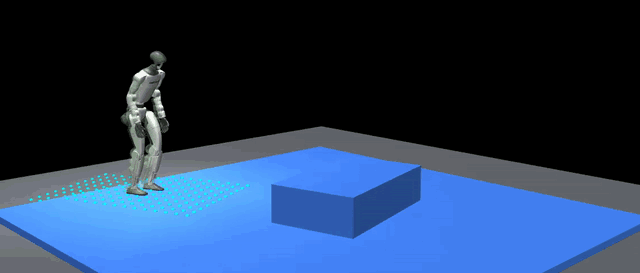
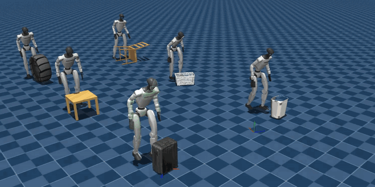
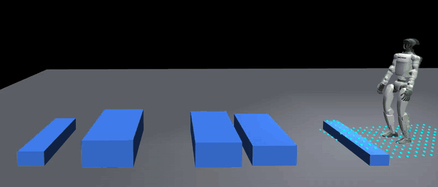
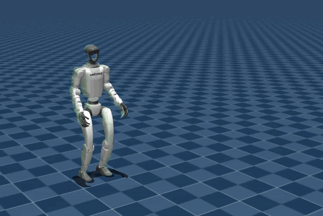
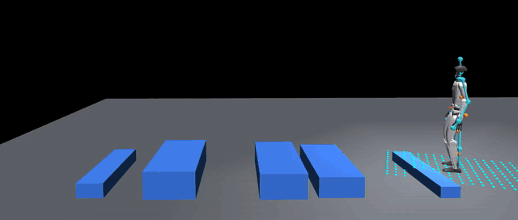
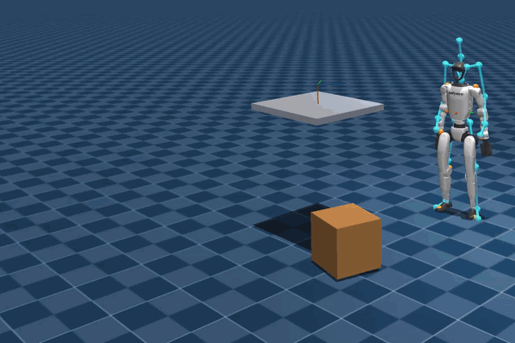
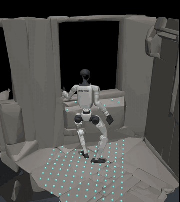

#  orcs

*Optimize, Retarget, Control Suite*

training and retargeting tools for privileged humanoid control:

- LoRA adaptation of [SONIC](https://nvlabs.github.io/GEAR-SONIC/)
- kinodynamic retargeting of SMPL motions
- adapter and experimental *tabula rasa* training

## tasks

<table>
  <tr>
    <td align="center">
      <a href="src/orcs/tasks/perloco"></a><br>
      <code>Orcs-PerLoco-OmRe-AdaptSonic</code>
    </td>
    <td align="center">
      <a href="src/orcs/tasks/uolm"></a><br>
      <code>Orcs-Uolm-AdaptSonic</code>
    </td>
  </tr>
  <tr>
    <td align="center">
      <a href="src/orcs/tasks/perloco"></a><br>
      <code>Orcs-PerLoco-Grail-AdaptSonic</code>
    </td>
    <td align="center">
      <a href="src/orcs/tasks/dodge"></a><br>
      <code>Orcs-Dodge-AdaptSonic</code>
    </td>
  </tr>
  <tr>
    <td align="center">
      <a href="src/orcs/tasks/perloco"></a><br>
      <code>Orcs-PerLoco-Grail-AdaptSonic-Smpl</code>
    </td>
    <td align="center">
      <a href="src/orcs/tasks/uolm"></a><br>
      <code>Orcs-Uolm-SmallCubeTable-AdaptSonic-Smpl</code>
    </td>
  </tr>
  <tr>
    <td align="center">
      <a href="docs/ego_htr.md"></a><br>
      <code>Orcs-PerLoco-EgoHtr-AdaptSonic</code>
    </td>
    <td></td>
  </tr>
</table>

## install

Requires [uv](https://docs.astral.sh/uv/getting-started/installation/), Git LFS,
and GitHub SSH access.

```bash
git clone https://github.com/lok-i/orcs && cd orcs
uv venv --prompt orcs
source .venv/bin/activate
```

full:

```bash
bash scripts/setup/sync_deps.sh
bash scripts/setup/sync_data.sh
```

lean:

```bash
bash scripts/setup/sync_deps.sh --no-smpl
bash scripts/setup/sync_data.sh --no-smpl
```

`--no-smpl` skips SMPL support as full setup prompts for three licensed SMPL-X model files (details: [PerLoco](docs/perceptive_locomotion.md) · [SMPL retargeting](docs/smpl_retargeting.md)).

## play

```bash
# release: one policy for rocky ascent + window crossing
play Orcs-PerLoco-EgoHtr-AdaptSonic --agent release --num-envs 2 --viewer viser

# initial
play Orcs-Uolm-AdaptSonic --agent initial --viewer native

# trained
play Orcs-PerLoco-OmRe-AdaptSonic --agent trained \
  --checkpoint-file /path/to/checkpoint.pt --viewer native # from local checkpoint

play Orcs-PerLoco-OmRe-AdaptSonic --agent trained \
  --wandb-run-path entity/project/run-id --viewer native # from wandb

# zero
play Orcs-PerLoco-Grail-AdaptSonic-Smpl --agent zero --viewer native

# random
play Orcs-Uolm-SmallCubeTable-AdaptSonic-Smpl --agent random --viewer native
```

released checkpoints from [`lkrajan/orcs`](https://huggingface.co/lkrajan/orcs) are auto-downloaded on demand.

## train

```bash
train Orcs-Uolm-AdaptSonic --env.scene.num-envs 4096
train Orcs-PerLoco-Grail-AdaptSonic --env.scene.num-envs 4096
```

## retarget

**scripted**

```bash
orcs-pseudo-retarget --scene perloco-grail --all
orcs-pseudo-retarget --scene uolm --all
```

`--all`: every sample in the scene's default motion sets.
[options and setup](docs/smpl_retargeting.md).

**agentic**

launch the review viewer:

```bash
.venv/bin/python -m orcs.cli.ego_htr view --port 8085
```

then ask your coding agent:

```text
read src/orcs/ego_htr/SKILL.md. help me prepare and retarget
an EgoHTR clip, then revise it from my frame comments in the viewer.
```

> **note:** currently supports EgoHTR → G1 through UMR.
> [setup and workflow](docs/ego_htr.md#use).

## paths

| variable | default |
|---|---|
| `ORCS_DATA_ROOT` | `<repo>/data` |
| `ORCS_DEPS_ROOT` | `<repo>/dependencies` |
| `ORCS_ASSETS_SOURCE` | host assets checkout, then installed `assets` package |
| `ORCS_SMPLX_DIR` | `<deps>/body_models` |
| `ORCS_RELEASE_ROOT` | `~/.cache/orcs/releases` or `$XDG_CACHE_HOME/orcs/releases` |

## contributing

[Contribution guide](CONTRIBUTING.md): PR format, dependency changes and validation.

## license and credits

ORCS code and documentation are [BSD-3-Clause](LICENSE). Third-party code,
models, datasets, and body-model files retain their upstream terms; see
[THIRD_PARTY_NOTICES.md](THIRD_PARTY_NOTICES.md).

ORCS builds on [SONIC](https://nvlabs.github.io/GEAR-SONIC/),
[GRAIL](https://github.com/NVlabs/GRAIL),
[OmniRetarget](https://omniretarget.github.io/),
[DexMachina](https://github.com/MandiZhao/dexmachina),
[ResMimic](https://resmimic.github.io/),
[MimicKit](https://github.com/xbpeng/MimicKit),
[mjlab](https://github.com/mujocolab/mjlab),
[RSL-RL](https://github.com/leggedrobotics/rsl_rl),
[EgoHTR](https://huggingface.co/datasets/leggedrobotics/egohtr), and
[UMR](https://hanyang9.github.io/UMR/).
Thank you to their authors and contributors. Please cite the projects and datasets
you use.

## citation

`orcs` was developed as part of [ViBe](https://arxiv.org/abs/2609.09918). If you
use this repository in your research, please consider citing:

```bibtex
@misc{krishna2026vibe,
  title={ViBe: Visual Behavior Adaptation for Perceptive Humanoid Whole-Body Control},
  author={Lokesh Krishna and Sarvesh Venkatesan and An Zhang and Quan Nguyen},
  year={2026},
  eprint={2609.09918},
  archivePrefix={arXiv},
  primaryClass={cs.RO},
  url={https://arxiv.org/abs/2609.09918},
}
```
